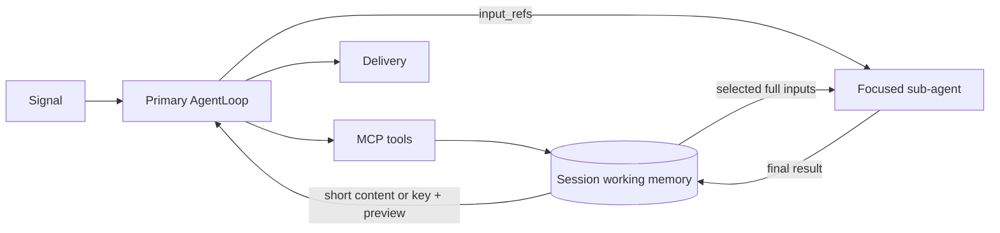
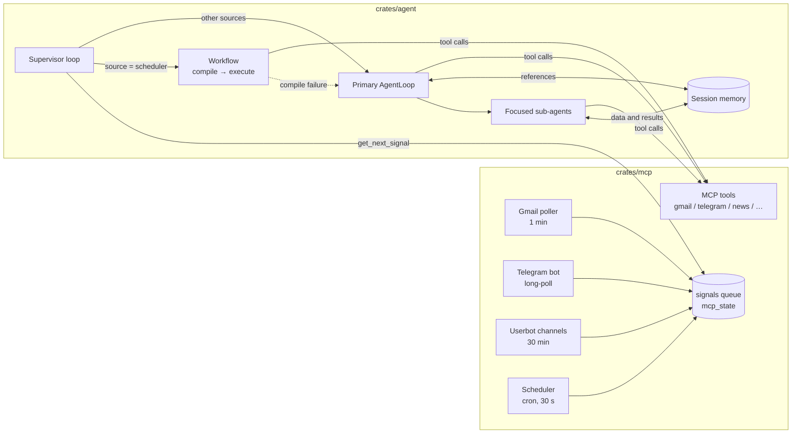

<p align="center">
  
</p>

<h1 align="center">Ouro helper</h1>

> A personal agent that reads your mail, watches your Telegram channels, tracks
> your bank feed — and acts on it. Built as two small processes talking strictly
> over the [Model Context Protocol](https://modelcontextprotocol.io).

<p align="center">
  <a href="#what-it-is"></a>
  <a href="#stack"></a>
  <a href="https://modelcontextprotocol.io"></a>
  <a href="#stack"></a>
  <a href="#stack"></a>
</p>

> 🚧 **Work in progress** — a personal project under active development;
> interfaces and internals change frequently.

---

## What it is

A **signal-driven personal-agent system**. External events (a new email, a
Telegram message, a cron tick) become *signals* on a queue. A supervisor pulls
them one at a time, loads a matching markdown *skill*, and runs a single LLM
session whose every side effect — a Telegram reply, a scheduled task, a DB
write — is an MCP tool call.

Independent processes in one Cargo workspace, with the Rust application
managed by systemd and the sandbox/database in containers:

| Crate | Role | Knows about |
| --- | --- | --- |
| **`crates/mcp`** (`mcp-tools`) | Stateless MCP server. Wraps Gmail / Telegram / Monobank / news as primitive tools; runs the pollers that turn external events into signals. | Nothing about the agent. |
| **`crates/agent`** (`agent-supervisor`) | Agent supervisor. Pulls one signal and runs a primary AgentLoop with shared working memory and focused sub-agents. | Nothing about MCP internals — only the tools the protocol exposes. |
| **`crates/codex`** (`codex-service`) | The sandbox `code_agent` and the codex judge run `codex exec` in. | Nothing else. |
| **`crates/evals`** | Per-node judge, judge-noise calibration, the improver gate and closed-loop improver, trace replay, golden-set evals. | The agent's trace mirror and Langfuse. |

Neither the server nor the agent imports code from the other. The boundary
*is* the protocol.

The system was TypeScript until October 2026; both processes were ported to
Rust (the droplet has 2 GB) with their tests one to one, and the TS packages
were then removed. Databases, migrations and trace shapes are unchanged.

## AgentLoop and working memory

The primary agent handles each signal in a ReAct loop: call tools, observe
results and decide the next action. It can delegate several focused tasks
to sub-agents, each with a fresh conversation and the same session memory.
The primary uses the `smart` preset; workers choose a preset for their task.



Ordinary tool schemas and arguments stay unchanged. Runtime stores every
ordinary tool result under a fresh memory key. Results up to 8,000 UTF-8
bytes include full `content`; larger ones include a preview of at most 512
bytes. `working_memory_get` explicitly loads a full value into the calling
agent's context. `put`, `list` and `delete` manage the temporary string KV.
Memory operations return directly, without creating another stored copy.

`invoke_sub_agent` accepts `input_refs`: runtime loads those exact values
into the worker's user message without copying them into the parent's
history. Workers return full final answers normally; runtime decides whether
the parent sees their complete content or a memory reference. A worker cannot
spawn further workers. A general focused task can omit the optional `skills`.

The parent owns completion and delivery unless it explicitly assigns delivery
to a worker. Normal delivery calls take actual text; the parent can explicitly
read a result when needed. Dependent bookkeeping follows a successful send.
Temporary memory is shared through the task and its recovery, then released.
Persistent `set_memory` and MCP knowledge storage remain separate.

Each signal has one Langfuse trace and a local mirror. The primary loop,
LLM iterations (including usage), tools, memory references and nested workers
form a single observation tree. Full tool output stays in the tool span;
generation input records exactly the context that iteration saw. Recovery
is recorded in the same trace. Langfuse export uses the configured
`LANGFUSE_*` credentials; without them the local recorder still runs.

Routing is deterministic and by source, not by content. `scheduler` signals
are compiled into a workflow (`workflow.rs`: compile → execute) as before —
a cron body is known in advance, so a plan is cheaper and more predictable
than an agentic loop. Every other source runs the primary AgentLoop. A
scheduler signal whose plan fails to compile degrades to the AgentLoop in the
same trace; an execution failure is reported through recovery instead of being
retried, because earlier steps may already have delivered. The AgentLoop does
not expose a workflow tool.

For incoming `telegram` signals the supervisor loads recent history of the
same chat/topic before the first LLM turn (`crates/agent/src/supervisor.rs`):
a bounded inline excerpt plus the full fetched history under the
`telegram.history` memory key for `input_refs`. No other source preloads it,
and a failed fetch never blocks the reply.

## How a signal becomes action



1. A poller notices something new and records a signal (source, content, envContext) —
   one row in the `signals` queue.
2. The supervisor (`crates/agent/src/supervisor.rs`) loops on
   `get_next_signal`; with an empty queue it waits on `wait_for_signal`,
   which answers the moment a poller records one — no polling delay.
3. The supervisor creates the session context and trace. A `scheduler`
   signal goes to the workflow runner (`planner` compiles the steps, the
   executor walks them); every other source starts the primary AgentLoop with
   `orchestrator` and `routing` instructions. Telegram signals also load their
   transport skill (and their recent chat history).
4. Domain work is delegated with the appropriate skill and memory references.
   The parent decides subsequent actions and delivers the result. On a fatal
   loop error, a bounded recovery agent reports the failure in the same session.

**Adding a new domain = dropping a `skills.default/<name>.md` and emitting
signals with `source=<name>`.** No supervisor change.

## Skills

Markdown prompts, two-layered: `skills.default/` is git-tracked and shipped in
the deployment; `skills/` is a gitignored live overlay (`/var/lib/ouro/skills` on prod) that the
agent's `dreaming` skill rewrites when it self-revises. `read_skill(name)`
checks the overlay first.

Skills are named after signal sources — one per domain (bills, news digests,
Telegram chat, scheduled tasks, …) plus a few meta-skills: `routing` (always
loaded on the primary), `orchestrator`, `worker`, `recovery`, `planner`
(the workflow compiler's prompt, used for scheduler signals), and `dreaming`
(self-revision).

## MCP tools

Defined next to their domain in `crates/mcp/src/<domain>.rs`. The agent calls them over StreamableHTTP;
locally they're also registered with Claude Code via `.mcp.json`. Grouped by
integration:

**Gmail** (mail + attachments) · **Telegram bot** (send/edit messages, chat
history) · **Telegram userbot** (read-only MTProto channel reading) ·
**Monobank** (transactions) · **News / RAG** (headlines, article fetch,
semantic `search_news` over HN + Habr + channel posts) · **PDF / files** ·
**Skills** (`list_skills`, `read_skill`) · **Unified memory** (projects of
markdown documents + facts, semantic `recall` across both, versioned
patch/revert) · **Signals queue** · **Scheduler** (cron tasks) · **Env**
(timezone)

## Layout

```
mcp-tools/
├── docker-compose.yml      postgres, mcp (+ tunnel), agent, codex, eval workers
├── skills.default/         shipped skills (git-tracked fallback)
├── skills/                 live overlay (gitignored; dreaming writes here)
└── crates/
    ├── mcp/                one domain per file: gmail.rs, telegram.rs, news.rs,
    │                       memory.rs, scheduler.rs, …; main.rs is the composition
    │                       root, src/bin the one-shot CLIs, specs/ the executable
    │                       specification
    ├── agent/              supervisor.rs (poll loop), workflow.rs (scheduler path),
    │                       agent.rs (engine + AgentLoop), mcp.rs (client),
    │                       skills.rs, tracing/langfuse
    ├── codex/              codex-service
    └── evals/              judge, improver, replay, golden-set evals
```

Domain code follows a strict **modules + dependency-injection** discipline:
every long-lived handle is built in a composition root (`main.rs`) and passed
down, seams are traits, no global singletons. See `CLAUDE.md` for the full
rules. Async orchestration is tokio with explicit concurrency limits and a
cancellation token threaded into every HTTP call; automatic retries live in
one layer (`providers.rs`) and never replay a tool side effect.

## Stack

Rust 2024 · tokio · [`rmcp`](https://github.com/modelcontextprotocol/rust-sdk)
(MCP, stdio + Streamable HTTP) · axum · tokio-postgres + pgvector · rusqlite ·
reqwest (Gmail REST, Telegram Bot API, OpenAI-compatible model APIs) ·
grammers (MTProto userbot) · croner · Langfuse (OTLP) · proptest · cucumber.

## Getting started

```bash
# one-time credentials (each is a binary: cargo run -p mcp-tools --bin <name>)
gmail-auth            # Gmail OAuth → mcp_state
userbot-auth          # MTProto login (phone + code)
telegram-get-chat-id

# run (two terminals); databases are created and migrated on boot
cargo run --release -p mcp-tools --bin mcp-tools          # MCP server + pollers
cargo run --release -p agent --bin agent-supervisor       # supervisor loop
```

> ⚠️ Don't run the MCP server locally while the production instance is up —
> Telegram `getUpdates` is exclusive; a second poller causes 409 Conflict
> and silently eats updates.

Env files: `.env.mcp` (integration creds + `OPENAI_API_KEY` for embeddings),
`.env.agent` (model keys + presets), `.env.postgres` (PG credentials).
Examples are checked in as `*.example`.

### Useful commands

| Command                                                | What it does                                             |
| ------------------------------------------------------ | -------------------------------------------------------- |
| `cargo test`                                           | Every crate's tests (Postgres via a testcontainer)       |
| `cargo test -p mcp-tools --test specs`                 | The executable specification (`crates/mcp/specs`)        |
| `langfuse-trace` / `judge`                             | Inspect Langfuse traces / run the per-node judge         |
| `eval-snapshot` · `eval-rag` · `eval-inspect`          | RAG evaluation harness                                   |
| `embed-backfill`                                       | Re-embed `news_items` rows left without embeddings       |

## Deploy

```bash
scripts/deploy.sh                    # select services from runtime changes
scripts/deploy.sh agent              # explicitly rebuild/restart the agent
scripts/deploy.sh mcp                # both MCP instances, reconnect the agent
scripts/deploy.sh --runtime-image    # separately update Node/Python/Codex CLI
python3 scripts/test_deploy.py       # deployment regression checks, no Docker/SSH
```

The laptop cross-compiles only affected Linux binaries in a cached Docker
builder and sends changed executables and small runtime assets using rsync.
Production does not compile Rust. Test/spec/doc-only changes skip the build,
upload and restart. `DEPLOY_HOST` and `DEPLOY_DIR` override the SSH host and
server checkout (defaults: `root@165.22.199.65`, `/root/agent-helper`). The
commit must be clean and pushed; deployment checks out that exact commit.

- **systemd:** `ouro-mcp`, `ouro-mcp-tunnel`, `ouro-agent`, running as `ouro`.
- **Docker:** Postgres, the Codex sandbox, tunnel-client. `ouro-containers`
  starts the database/sandbox; `ouro-tunnel-client` waits for restricted MCP
  before starting the tunnel container and owns its retries.
- **Executables:** `/opt/ouro/bin`; shipped skills/gateway: `/opt/ouro/app`.
- **State:** `/var/lib/ouro/agent`, `/var/lib/ouro/skills`, `/var/lib/ouro/storage`.
- **Native environment:** `/etc/ouro/{agent,mcp,mcp-tunnel}.env` (root-only).
  These files become authoritative after migration; edit them on the server
  and restart the affected unit. Local `.env.agent` is not uploaded.
- **Container environment:** the server checkout's `.env.mcp` (tunnel keys)
  and `.env`/Compose interpolation (existing Postgres credentials).
- **Private endpoints:** MCP `127.0.0.1:3000`, restricted MCP `:3001`, Codex
  `:3010`, Postgres `:5432`. The tunnel container uses host networking to
  reach the loopback MCP. No application/database port is public.

The first deployment imports effective credentials and copies agent data,
live skills and attachments from the stopped legacy containers' volumes;
the old MCP/agent containers are removed before native startup. Postgres and
Codex keep their existing data volumes. The installed image supplies the
Codex runtime at bootstrap, without transferring another image.

Binaries are replaced by atomic rename. Only the current installation and
its revision marker are kept: **no previous release or rollback directory**.
Concurrent applies are locked and stale deployments are rejected. Endpoint
probes and the supervisor's MCP/skill validation must pass before recording
a successful deployment.

```bash
# On the server
systemctl status ouro-agent ouro-mcp ouro-mcp-tunnel ouro-tunnel-client
journalctl -u ouro-agent -f
systemctl restart ouro-agent
```
